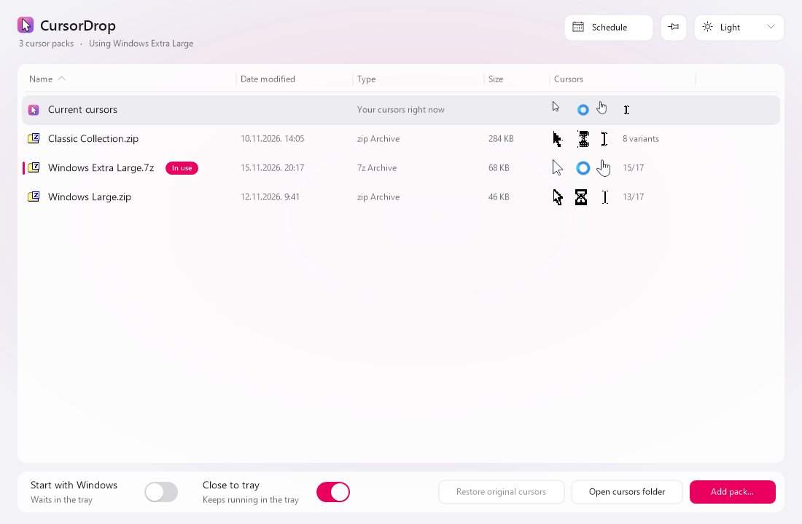
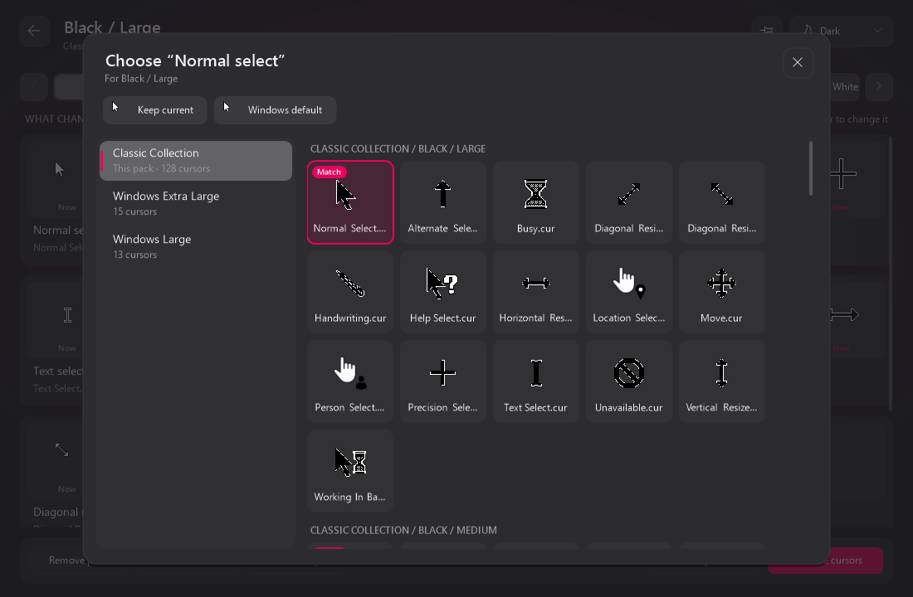
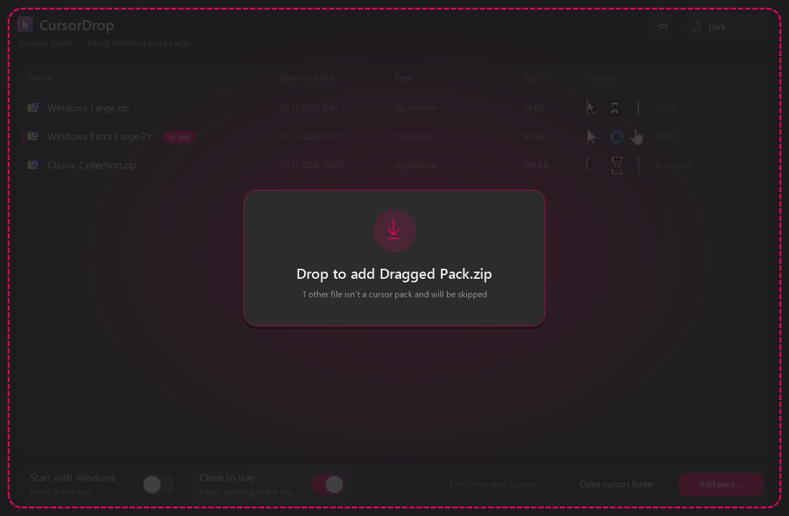

# CursorDrop

[](https://github.com/toasty-wheeler/CursorDrop/releases/latest)

Drop a mouse-cursor pack into a folder and it becomes your Windows cursors. No unzipping,
no right-click > Install on an `.inf`, no Control Panel.

CursorDrop is a small Windows app (Rust, no runtime needed) that watches its `cursors`
folder. Put a pack there as you downloaded it (`.zip`, `.7z` or `.rar`) and within a couple
of seconds it's applied. A window lists your packs and shows every cursor a pack will
replace before you use it.








## Download

Get the `CursorDrop-v…-win64.zip` from the [latest release](https://github.com/toasty-wheeler/CursorDrop/releases/latest),
unzip it anywhere and run `CursorDrop.exe`. It's portable: no installer and no admin rights. Windows 10 or 11, 64-bit.

## Using it

- **Add a pack:** put the archive in the `cursors` folder next to `CursorDrop.exe`, click
  **Add pack…**, or drag it onto the window (it lights up to show it'll take the pack, or
  warns if what you're dragging isn't one). It's applied straight away.
- **See what changes:** click a pack. Each of the 17 Windows cursors is shown as it is now
  and as it would be with the pack; animated `.ani` cursors play.
- **Change any cursor:** click a cursor in the grid to pick a different one: any cursor in
  the pack (handy when its file names don't say what they are), from another pack or preset,
  **Keep current** or **Windows default**. Changed cursors are marked **Edited**; **Reset
  changes** puts the pack back.
- **Presets:** **Current cursors**, always first in the list, shows what you use now. Change
  any of its cursors (or a pack's) and **Save as preset…**: the cursors are copied into the
  preset, so it keeps working even if the packs are removed. Presets can be used, changed,
  renamed and deleted like packs, and are in the tray menu too.
- **Schedule:** the **Schedule** button opens a month's worth of weeks (Mon–Sun, no dates)
  that repeats every month: week 1 is the 1st–7th, week 2 the 8th–14th, up to week 5.
  Select days (tap them, or **Weekdays** / **Weekends** / **Every day**) and give them
  **One** set of cursors, a **Random pick** from several, **Random from all**, or **No
  change**; packs and presets can both be used. **+** under the weekend adds a week (up to
  5; with fewer, the weeks take turns within the month). **Special days**, picked in a date
  picker (a holiday, a birthday), come back every year and win over the weeks. With
  **Follow the schedule** on, each new day gets its cursors (a random pick stays the same
  all day).
- **Variants:** packs with several versions (sizes, colours, characters…) get browser-style
  tabs, named after their folders. Many variants scroll: use the arrows, the mouse wheel
  over the tabs, or Left / Right. Hover a tab to see its full name.
- **Undo:** CursorDrop remembers your cursors before it applies a pack. **Restore original
  cursors** brings them back, and so does deleting the pack from the folder (or
  **Remove pack**, which moves it to the Recycle Bin).
- **Tray:** with **Close to tray** on (the default), closing the window keeps CursorDrop in
  the tray, still watching the folder; turn it off and closing the window quits.
  **Start with Windows** starts it in the tray at sign-in.
- **Looks:** follows Windows' light/dark setting and accent colour, or pick Light / Dark;
  the pin keeps the window on top.

## How it works out the cursors

- If the pack has an install `.inf`, its cursor list is used as-is.
- Otherwise file names are matched to cursor roles: `Normal Select`, `Busy`, `Working In
  Background`, `Diagonal Resize 1`, `aero_ns`, `link`, `unavailable`, and so on.
- Every folder (or `.inf`) with cursors becomes one variant. Archives inside the archive
  (common for "all-in-one" packs) are opened too, up to three levels deep.
- Cursors a pack doesn't provide fall back to the Windows default.
- Only `.cur`, `.ani` and `.inf` files are extracted, and paths are checked so nothing can be
  written outside CursorDrop's folder.

Applying a pack writes your user's cursor settings (`HKEY_CURRENT_USER\Control Panel\Cursors`),
adds the scheme to Control Panel > Mouse > Pointers and tells Windows to reload the cursors.
Nothing system-wide is changed.

## Where things are kept

Next to `CursorDrop.exe`: `cursors\` (your packs) and `data\` (extracted cursors, settings,
a log). If that folder can't be written to, both live in `%LOCALAPPDATA%\CursorDrop`.

## Command line

| | |
|---|---|
| `CursorDrop.exe` | Opens the window (or brings up the running one). |
| `CursorDrop.exe --tray` | Starts in the tray only (used by Start with Windows). |
| `CursorDrop.exe --inspect <pack>` | Prints which file goes to which cursor; changes nothing. |
| `CursorDrop.exe --restore` | Restores the cursors you had before CursorDrop. |
| `CursorDrop.exe --version` | Prints the version. |

## Building

Needs Rust (MSVC toolchain) and the Windows SDK (for `rc.exe`; it comes with Visual Studio's
C++ workload). RAR support compiles the bundled UnRAR C++ source.

```
cargo build --release
```

`setup\package.bat` runs the tests, builds, and writes the release zip and its SHA-256 to
`dist\`.

For development, `CURSORDROP_SELFTEST=<folder>` installs the packs in the `cursors` folder
without applying them, renders every view to PNGs in `<folder>`, clicks through the UI and
prints `ok` / `FAILED` per check. No window is shown and your cursors aren't touched.
(`CURSORDROP_SELFTEST_NOW_DEFAULT=1` shows Windows' default cursors as "Now", as in the
screenshots above.)

## License

MIT, see [LICENSE](LICENSE). Third-party components and their licenses (including the
UnRAR license) are listed in [THIRD_PARTY_NOTICES.md](THIRD_PARTY_NOTICES.md).

The screenshots use the classic and large cursor sets that ship with Windows.
